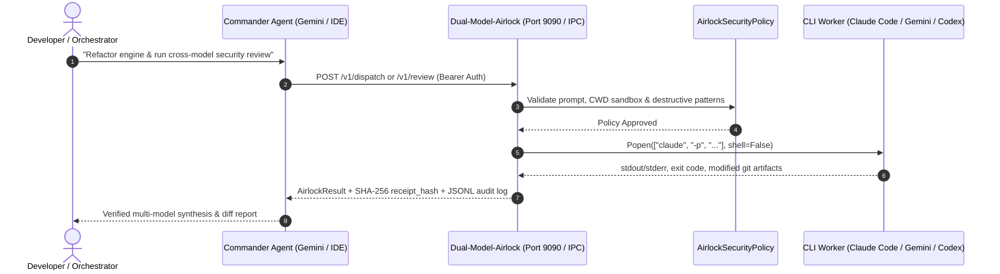

# Dual-Model-Airlock v2.0 🔱

> **Sovereign, Framework-Free IPC & REST Security Bridge Between Google Gemini, Claude Code CLI, Codex, and Aider.**  
> *Re-engineered zero-dependency alternative to AutoGen 0.4 — built for cross-model code execution, adversarial code review, and SKILL.md agent workflows.*

[](https://github.com/TrishulaSoftware/Dual-Model-Airlock/actions/workflows/ci.yml)
[](https://trishulasoftware.github.io)
[](LICENSE)
[](#)
[-brightgreen.svg)](#)
[](SKILL.md)

**Official Website & Sovereign Architecture Suite:** [**https://trishulasoftware.github.io**](https://trishulasoftware.github.io)

---

## ⚡ Why Dual-Model-Airlock?

Heavy multi-agent frameworks like **AutoGen 0.4** and **CrewAI** introduce massive dependency graphs (`25–35+` packages), breaking API churn, and hundreds of megabytes of actor overhead just to let one frontier model delegate a coding or verification task to another CLI agent.

**Dual-Model-Airlock v2.0** solves cross-model orchestration in **pure Python standard library (`0` third-party packages, `< 15 MB` RAM)**:
- **Multi-Agent CLI Auto-Discovery:** Automatically resolves installed CLI coding workers across Windows, macOS, and Linux (`claude`, `gemini`, `codex`, `aider`).
- **Adversarial Dual-Model Code Review (`review`):** Have Model A (e.g., Gemini Pro) write code and dispatch it through the Airlock to Model B (e.g., Claude Code CLI) for a structured 4-point security, concurrency, and bug audit.
- **Perimeter Security Gate (`AirlockSecurityPolicy`):** Neutralizes destructive shell patterns, enforces workspace `allowed_cwd_roots` sandboxing, gates raw shell execution, and protects the threaded REST gateway with Bearer token authentication (`AIRLOCK_API_KEY`) and a `1 MiB` payload ceiling.
- **Deterministic Process Control & Audit Receipts:** Tracks live OS `Popen` handles for real subprocess termination (`cancel_task`), detects modified git worktree artifacts automatically, and signs every execution with a SHA-256 `receipt_hash` + optional `JSONL` audit trail.
- **Native `SKILL.md` Compatibility:** Ships with a root [`SKILL.md`](SKILL.md) ready to drop into Claude Code, Cursor, Copilot, Antigravity, or **Agensi.io**.

---

## 🚀 Architecture Diagram



---

## 📦 Quickstart

### 1. Clone & Verify Environment (Zero `pip` Dependencies Required)
```bash
git clone https://github.com/TrishulaSoftware/Dual-Model-Airlock.git
cd Dual-Model-Airlock

# Discover installed local CLI coding agents (Claude Code, Gemini CLI, Codex, Aider)
python cli.py workers
```

*(Optional)* Install as a global/editable CLI command (`dual-model-airlock`):
```bash
pip install -e .
```

### 2. Dispatch a Cross-Model Task via CLI
```bash
# Execute directly through the local IPC bridge
python cli.py dispatch "Refactor vector_math.py for zero-copy memory safety" --worker claude

# Run a Dual-Model Adversarial Code Review on a file
python cli.py review airlock_bridge.py --worker claude --commander gemini-2.5-pro
```

### 3. Start the Threaded HTTP REST Gateway
```bash
python cli.py serve --port 9090 --api-key "my-secret-token" --audit-log airlock_audit.jsonl
```

#### Health & Worker Discovery Check
```bash
curl http://127.0.0.1:9090/health
```
```json
{
  "status": "online",
  "service": "Dual-Model-Airlock",
  "version": "2.0.0",
  "claude_available": true,
  "auth_enabled": true,
  "workers": {
    "claude": { "available": true, "binary": "/usr/local/bin/claude" },
    "gemini": { "available": true, "binary": "/usr/local/bin/gemini" },
    "codex":  { "available": false, "binary": null },
    "aider":  { "available": false, "binary": null },
    "mock":   { "available": true, "binary": "builtin://mock" }
  }
}
```

### 4. Python SDK Usage
```python
from airlock_core import AirlockTask, AirlockSecurityPolicy
from airlock_bridge import AirlockBridge

# Enforce workspace sandboxing and JSONL audit logging
policy = AirlockSecurityPolicy(
    allow_shell_worker=False,
    allowed_cwd_roots=["."]
)
bridge = AirlockBridge(policy=policy, audit_log_path="airlock_audit.jsonl")

# 1. Standard Task Dispatch
task = AirlockTask(
    prompt="Generate edge-case unit tests for token bucket rate limiter",
    commander="gemini-2.5-pro",
    worker="claude",
    timeout_sec=180
)
result = bridge.execute_task(task)
print(f"Status: {result.status.value} | Receipt: {result.receipt_hash}")
print(f"Artifacts Modified: {result.artifacts_generated}")

# 2. Dual-Model Adversarial Code Review
review_res = bridge.execute_review(
    target="airlock_server.py",
    commander="gemini-2.5-pro",
    worker="claude"
)
print(review_res.stdout)
```

---

## 🛡️ SWOT Hardening & Benchmark Matrix (v2.0)

| Capability | AutoGen 0.4 | CrewAI | Dual-Model-Airlock v2.0 |
| :--- | :---: | :---: | :---: |
| **External Dependencies** | 25+ packages | 35+ packages | **0 (Pure Python Standard Library)** |
| **Gemini ↔ Claude Code CLI Pipe** | Custom Actor Required | Not Native | **Native IPC + Threaded REST** |
| **Built-In Cross-Model Code Review** | Manual Setup | Manual Setup | **`cli.py review` & `POST /v1/review`** |
| **Perimeter Security Gate** | External | External | **`AirlockSecurityPolicy` + CWD Sandbox + Bearer Auth** |
| **Cryptographic Execution Receipts** | None | None | **SHA-256 `receipt_hash` + JSONL Audit Trail** |
| **Memory Footprint** | ~350 MB | ~600 MB | **< 15 MB** |
| **`SKILL.md` Agent Store Ready** | No | No | **Yes ([`SKILL.md`](SKILL.md) included)** |

---

## 🧪 Running the Test Suite

```bash
python -m unittest discover -s . -p "test_*.py" -v
```

---

## 📜 License & Attribution

Distributed under the **MIT License**. Engineered by [**Trishula Software**](https://trishulasoftware.github.io).  
*Pierce The Heavens 🔱*
