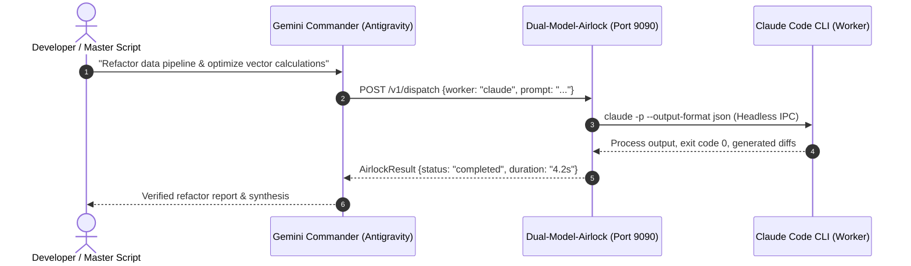

# Dual-Model-Airlock 🔱

> **Framework-Free IPC & REST Bridge Between Google Gemini and Claude Code CLI.**  
> *Re-engineered sovereign alternative to AutoGen 0.4. Zero actor bloat. Zero dependency churn.*

[](LICENSE)
[](#)
[](#)
[](#)

---

## ⚡ The Problem with AutoGen 0.4 & Heavy Multi-Agent Frameworks

Frameworks like Microsoft **AutoGen 0.4** and **CrewAI** suffer from severe structural drawbacks when bridging frontier models:
1. **Breaking Architectural Churn:** AutoGen broke complete backwards compatibility between v0.2 and v0.4, rewriting core event loops and deprecating working setups.
2. **Actor Over-Engineering:** Hundreds of files of event loops, reactive streams, and gRPC scaffolding just to send a prompt to another model and get an answer.
3. **Execution Sandboxing Friction:** Inability to smoothly delegate complex codebase tasks directly to CLI coding agents like **Claude Code (`claude -p`)**.

**Dual-Model-Airlock** provides a clean, standard-library HTTP & IPC bridge that enables a **Commander Agent** (such as Google Gemini Pro in Antigravity or a sovereign master script) to dispatch tasks directly to a **Worker Agent** (such as Claude Code CLI), stream results, inspect artifacts, and maintain complete audit logs.

---

## 🚀 Architecture Diagram



---

## 📦 Quickstart

### Prerequisites
- Python 3.10+
- Anthropic Claude Code CLI installed (`npm install -g @anthropic-ai/claude-code`)

### Starting the Airlock Server
Run the local HTTP REST gateway:
```bash
python -m dual_model_airlock.cli serve --port 9090
```

### Health Check
```bash
curl http://127.0.0.1:9090/health
```
```json
{
  "status": "online",
  "service": "Dual-Model-Airlock",
  "version": "1.0.0",
  "claude_available": true
}
```

### Dispatching a Task via CLI
```bash
# Execute directly through the bridge
python -m dual_model_airlock.cli dispatch "Review src/engine.py for memory leaks" --worker claude

# Or dispatch remotely through the running server
python -m dual_model_airlock.cli dispatch "Generate unit tests" --worker claude --remote
```

### Python API
```python
from dual_model_airlock import AirlockBridge, AirlockTask

bridge = AirlockBridge()

# Dispatch task to Claude Code CLI
task = AirlockTask(
    prompt="Refactor statistical models into vectorized NumPy arrays",
    commander="gemini-2.5-pro",
    worker="claude",
    timeout_sec=180
)

result = bridge.execute_task(task)
print(f"Status: {result.status} | Exit Code: {result.exit_code}")
print(f"Stdout:\n{result.stdout}")
```

---

## 📊 Comparison Matrix

| Feature | AutoGen 0.4 | CrewAI | Dual-Model-Airlock |
| :--- | :---: | :---: | :---: |
| **External Dependencies** | 25+ packages (tiktoken, etc.) | 35+ packages | **0 (Pure Python Standard Library)** |
| **Gemini ↔ Claude CLI Pipe** | Difficult / Custom Actor | Not supported natively | **Native Out-of-the-Box** |
| **Memory Footprint** | ~350 MB | ~600 MB | **< 15 MB** |
| **Setup Time** | 20+ minutes | 15+ minutes | **< 10 seconds** |
| **Telemetry / Tracking** | Microsoft Telemetry | Telemetry included | **0% Sovereign** |

---

## 📜 License
Distributed under the **MIT License**. Part of the Trishula Sovereign Architecture. Pierce The Heavens 🔱.
